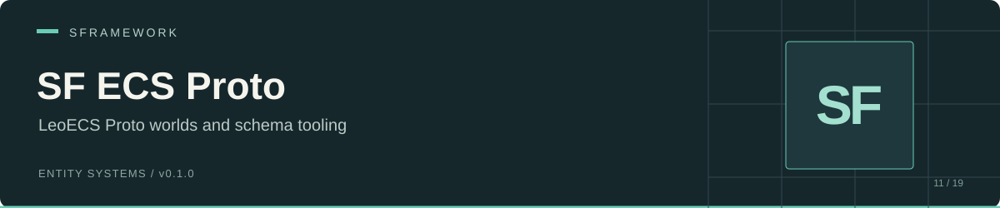
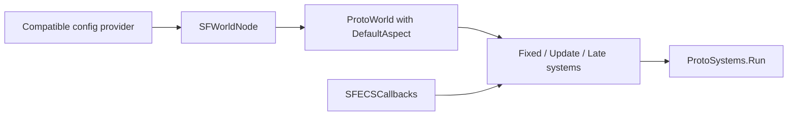

# SF ECS Proto

[Documentation website](https://docs.secretplace.studio/#sf-ecs-proto)

Unity entities, inspector providers, and configured update pipelines for **LeoECS Proto** in SFramework. This package uses Proto worlds and packed entities, plus Odin inspector attributes.

 

[Install](#installation) · [Worlds](#world-configuration) · [Systems](#writing-a-system) · [Entities](#entity-lifecycle-and-mapping) · [API](#public-api) · [Limits](#known-limits)

## Compatibility checkpoint

The checked branches expose unresolved integration differences:

- [SFWorldsConfig](Runtime/SFWorldsConfig.cs) references `SFConfig`, `ISFConfigsGenerator`, and `SFGenerationData`. The checked `sf-configs/main` sources do not define those types.
- [SFWorldsService](Runtime/SFWorldsService.cs) calls `ISFConfigsService.GetRepositories<T>()`, which the checked SF Configs interface does not expose.
- The worlds service has `Dispose()` but lacks `Init(CancellationToken)`, which the checked `sf-core/main` service contract requires.
- The [provider generator](Editor/SFComponentsGenerator.cs) emits `using SFramework.ECS.Runtime;`, while this package defines its provider and entity types in `SFramework.ECS.Proto.Runtime`.

Align those APIs and the generated import before using this as a complete Unity setup. This README does not identify compatible historical dependency revisions.

## Installation

Add the package through Unity Package Manager's **Add package from git URL**:

```text
https://github.com/huran438/sf-ecs-proto.git#main
```

The package ID is `sp.sframework.ecs.proto`, version `0.1.0`. [package.json](package.json) declares neither dependencies nor a minimum Unity version.

| Required assembly / asset | Use |
| --- | --- |
| `SFramework.Core.Runtime`, `SFramework.Core.Editor` | [SF Core](https://github.com/huran438/sf-core); views, injection, and editor tools. |
| `SFramework.Configs.Runtime` | [SF Configs](https://github.com/huran438/sf-configs); world configuration. Resolve the API differences above. |
| `Leopotam.EcsProto`, `Leopotam.EcsProto.QoL` | A compatible LeoECS Proto + QoL installation. Lite assemblies do not satisfy these references. |
| Odin Inspector / Serializer | A separately licensed Odin installation supplying the referenced Sirenix DLLs. The package does not bundle Odin. |

The [runtime asmdef](Runtime/SFramework.ECS.Proto.Runtime.asmdef) references `Sirenix.OdinInspector.Attributes`, `Sirenix.Serialization`, `Sirenix.Utilities`, and `Sirenix.Serialization.Config` DLLs. The [editor asmdef](Editor/SFramework.ECS.Proto.Editor.asmdef) also references Odin's editor and utilities editor DLLs.

## World configuration

`SFWorldsConfig.Worlds` holds `SFWorldNode` entries. Each node has an `Id`, a `Config`, and three arrays of `SFSystemContainer`: `FixedUpdateSystems`, `UpdateSystems`, and `LateUpdateSystems`.

The service loads config repositories in its constructor. For each unique node ID, it creates a `ProtoWorld(new DefaultAspect())`, creates three `ProtoSystems` collections, adds enabled systems in array order, then calls `Init()` on each collection.



Configure non-null arrays, including empty arrays for unused phases. The service iterates them without null checks. Duplicate world IDs return without adding another world.

`GetWorld()` and unknown names return a separate fallback world. `Worlds` returns configured worlds from the dictionary; it excludes that fallback. The fallback world has no configured system pipeline.

`SFWorldConfig` exposes capacity fields, but the Proto service does not read them. Its world construction uses `DefaultAspect` without forwarding those settings.

## Writing a system

Use Proto interfaces and the Proto namespace. `SFSystem.Init` injects through SF Core, then calls your `OnInit`. `Run()` and `Destroy()` forward to your overrides.

```csharp
using System;
using Leopotam.EcsProto;
using SFramework.ECS.Proto.Runtime;

namespace Example.Proto
{
    public sealed class CountTicksSystem : SFSystem
    {
        public int TickCount { get; private set; }

        protected override void OnInit(IProtoSystems systems)
        {
            TickCount = 0;
        }

        protected override void OnRun()
        {
            TickCount++;
        }

        protected override void OnDestroy()
        {
        }
    }

    public static class GameplayWorldConfig
    {
        public static SFWorldNode CreateNode()
        {
            return new SFWorldNode
            {
                Id = "Gameplay",
                Config = new SFWorldConfig(),
                FixedUpdateSystems = Array.Empty<SFSystemContainer>(),
                UpdateSystems = new[]
                {
                    new SFSystemContainer
                    {
                        Enabled = true,
                        System = typeof(CountTicksSystem).AssemblyQualifiedName
                    }
                },
                LateUpdateSystems = Array.Empty<SFSystemContainer>()
            };
        }
    }
}
```

Put the node in `SFWorldsConfig.Worlds` through your compatible configuration provider before constructing the worlds service. The sample defines the node and system; the unresolved dependency APIs prevent a verified bootstrap recipe against current SF Core / Configs.

`System` stores an assembly-qualified type name. The service uses `Type.GetType` and `Activator.CreateInstance`; use concrete `IProtoSystem` types with parameterless constructors. It skips disabled entries, unresolved names, and instances that do not implement `IProtoSystem`. An exception thrown during construction can still interrupt setup.

Adding the same type to different phases creates separate instances. The `SFExtensions.Add(params ISFSystem[])` helper adds only items that also implement `IProtoSystem`.

## Entity lifecycle and mapping

`SFEntity` extends Core's `SFView`. Its `Init()` discovers providers and determines whether the GameObject has an ancestor `SFEntity`. Its `OnEnable()` creates an entity in the selected world and adds `GameObjectRef`, `TransformRef`, and, for a root entity, `RootEntity`.

Every disable removes the mapping and deletes the entity. Re-enabling creates a new packed handle. Inject and initialize the view before enable; `OnEnable()` requires the service and provider array. Supply the world string expected by `GetWorld`, which indexes configured worlds by node `Id`.

This lookup helper works with the automatically installed reference component:

```csharp
using Leopotam.EcsProto.QoL;
using SFramework.ECS.Proto.Runtime;
using UnityEngine;

namespace Example.Proto
{
    public static class EntityAccess
    {
        public static bool TryGetHandle(
            GameObject target, out ProtoPackedEntityWithWorld handle)
        {
            handle = default;
            return target != null &&
                   target.TryGetEntityPacked(out handle) &&
                   handle.Unpack(out _, out _);
        }
    }
}
```

`TryGetEntityPacked` alone confirms a dictionary entry. `Unpack` checks whether the handle still identifies a live entity. `SFEntityMapping.Clear()` removes mapping entries without deleting world entities.

## Component providers and aspects

`SFComponent<T>.Setup` runs `IEcsAutoInit<T>.AutoInit(ref T)`, unpacks the entity, and calls `world.Pool<T>().SetRaw(entity, _value)`. Its `Value` property returns the authoring struct by reference; setup copies that data into ECS storage.

The [DefaultAspect](Runtime/DefaultAspect.cs) declares pools for only `GameObjectRef`, `TransformRef`, and `RootEntity`. The worlds service hardcodes this aspect and exposes no custom-aspect factory. A custom provider also needs its component pool in a compatible Proto aspect and the appropriate pool-add/setup behavior. This repository does not provide a complete custom-component registration path, so attaching a provider alone is not a verified recipe.

The generator scans `[SFGenerateComponent]` structs and writes `_StructName.cs` next to `StructName.cs` in the struct's namespace. It supports `CustomBaseType`, skips existing files by default, and force-regenerates through **Edit → SFramework → Regenerate ECS Components**. It stops that generation pass if it cannot find an exact `<TypeName>.cs` source asset. Resolve the incorrect generated namespace import before use.

In editor builds, providers call `ISFDrawGizmos`, `ISFDrawGizmosSelected`, and `ISFOnValidate` hooks on their authoring value. These calls box struct values; do not rely on mutations to persist back into `_value`.

## Public API

| API | Behavior |
| --- | --- |
| [`ISFWorldsService`](Runtime/ISFWorldsService.cs) | `GetWorld(string name = "")` and configured `Worlds`. |
| [`SFSystem`](Runtime/SFSystem.cs) | Abstract `OnInit(IProtoSystems)`, `OnRun()`, and `OnDestroy()` hooks. |
| [`SFEntity`](Runtime/SFEntity.cs) | `EcsPackedEntity`; enable/disable lifecycle. |
| [`SFComponent<T>`](Runtime/SFComponent.cs) | Authoring `Value`, auto-initialization, and Proto `Setup`. |
| [`SFEntityMapping`](Runtime/SFEntityMapping.cs) | World/entity lookup, packed lookup, and `Clear()`. |
| [`SFExtensions`](Runtime/SFExtensions.cs) | `Add(params ISFSystem[])`, `GameObject.TryGetEntity`, and `TryGetEntityPacked`. |
| [`SFWorldsConfig`](Runtime/SFWorldsConfig.cs), [`SFWorldNode`](Runtime/SFWorldNode.cs) | Configuration tree and phase lists. |
| [`SFSerializableType`](Runtime/SFSerializableType.cs) | Serialized assembly-qualified type reference, conversions, and type-filter attribute. |

## Known limits

- `Dispose()` clears system lists and unsubscribes callbacks. It does not call `ProtoSystems.Destroy()`, destroy worlds, or destroy the persistent callback GameObject. Your `SFSystem.OnDestroy()` hook therefore needs host-driven systems destruction to run.
- Renaming an assembly or system invalidates stored type strings. Check them when no expected system appears.
- `SFSerializableType` can retain a non-empty unresolved name while its `Type` stays null. Its drawer also assumes the filtered type list contains at least one entry.
- Mapping overloads lack null guards. Check a GameObject before lookup.
- Missing world names fall back without an error. Confirm the returned world before authoring entities into a named world.

## Validation and related packages

This README describes source at commit [`7abc06a`](https://github.com/huran438/sf-ecs-proto/commit/7abc06a562b91d364f4e43ea3911f7bcea808274). The examples received static source review only. No Unity compilation, Play Mode, player build, or automated test execution accompanied this documentation. The package declares no minimum Unity version, and custom Proto pool/aspect behavior still needs validation with your chosen external dependencies.

[SF Core](https://github.com/huran438/sf-core) and [SF Configs](https://github.com/huran438/sf-configs) provide the supporting contracts. [SF ECS](https://github.com/huran438/sf-ecs) and [SF ECS Odin](https://github.com/huran438/sf-ecs-odin) use LeoECS Lite. [SF ECS Tween](https://github.com/huran438/sf-ecs-tween) targets the Lite assembly and does not supply Proto systems.

## License

[MIT](LICENSE.md). Odin and the other dependencies retain their own licensing terms.
